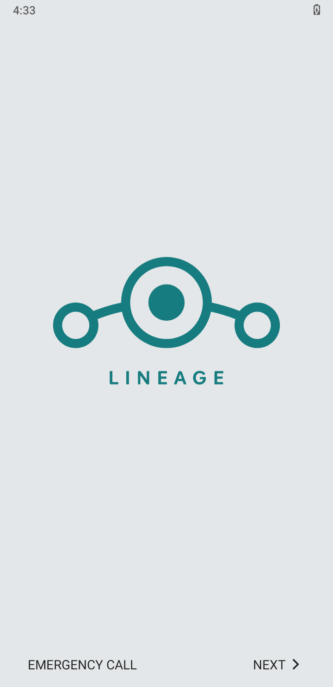
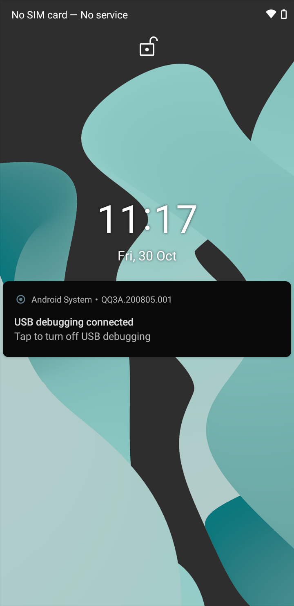

# j8-a10

**LineageOS 17.1 · Android 10 · Samsung Galaxy J8 (SM-J810G / `j8y18lte`)**

A from-source Android 10 bring-up project for the Samsung Galaxy J8: pinned
manifest, device tree with local fixes, kernel and vendor pins, build tooling,
image/OTA packaging notes, install and recovery instructions, and the complete
engineering record of what works, what does not, and why.

The Galaxy J8 is a Snapdragon 450 (`msm8953`) device with **32-bit vendor
blobs** — 32-bit userspace on a 64-bit kernel (`arm32_binder64`). It shipped
with Android 8.0 and has no official Android 10 base, which is why a device
tree, kernel rebuild and vendor blob set are all part of the story.

---

## Status

> **It boots.** Android 10 builds, is signed with the project's own release
> keys, installs through TWRP, and reaches a working LineageOS UI on the
> device. The validated build is the **permissive diagnostic** one; the
> **enforcing** OTA is built and verified but has not had its cold boot yet.
> Full evidence: [STATUS.md](STATUS.md) · [VALIDATION.md](VALIDATION.md).

| Stage | Result |
|---|---|
| Source sync (LineageOS 17.1 + device/kernel/vendor pins) | ✅ complete |
| Kernel build (3.18.140, arm64, `Image.gz-dtb`) | ✅ complete |
| `system.img` / `vendor.img` / `boot.img` / `recovery.img` | ✅ produced |
| OTA ZIP (`lineage-17.1-*-UNOFFICIAL-j8y18lte.zip`, 543 MB) | ✅ produced |
| Release-key signing | ✅ applied (`release-keys`) |
| TWRP install + data format | ✅ done |
| First boot (`sys.boot_completed=1`, Setup Wizard) | ✅ done |
| Hardware validation | ⚠️ partial — [results](VALIDATION.md) |
| Enforcing cold boot | ⛔ pending (device offline) |

<p align="center">
  
  
</p>

Two build blockers had to be fixed to get here, both in the device tree:

1. **`e2fsdroid` could not label `/firmware`** — `$(LOCAL_PATH)` in
   `BoardConfig.mk` resolved to `system/sepolicy` in the decisive parse pass, so
   the device's own sepolicy directory never reached
   `BOARD_VENDOR_SEPOLICY_DIRS` and every device context (including `/firmware`)
   was silently dropped from the image.
2. **`vendor_property_contexts` failed its self-check** — a missing trailing
   newline in `sepolicy/property_contexts` glued the last rule to the next
   file's first line during the policy concatenation.

Both are analysed in
[docs/build-troubleshooting.md](docs/build-troubleshooting.md), and both fixes
are in [`patches/`](patches/).

---

## Device at a glance

| Property | Value |
|---|---|
| Model | SM-J810G (Galaxy J8, 2018) |
| Codename | `j8y18lte` |
| SoC | Qualcomm Snapdragon 450 / `msm8953` (8× Cortex-A53 @ 1.8 GHz) |
| GPU | Adreno 506 |
| RAM / storage | 4 GB / 64 GB eMMC |
| Display | 720 × 1480, ~280 dpi, 60 Hz |
| Shipped OS | Android 8.0 |
| Target OS | LineageOS 17.1 (Android 10, API 29) |
| Kernel | 3.18.140, arm64 (`Image.gz-dtb`), 32-bit userspace |
| ABI | `armeabi-v7a` only (`zygote32`) |
| System partition | 3,397,386,240 B (~3.16 GiB) |
| Vendor partition | 503,316,480 B (480 MiB) |

Full hardware, partition table and boot-image header reference:
[docs/device.md](docs/device.md).

---

## Quick start (build)

Requirements: Ubuntu 22.04 x86_64 (or WSL2), ~150 GB free, 12 GB+ RAM,
JDK 11, Python 3, `repo`, and the standard AOSP build packages.

```bash
mkdir -p ~/android/lineage-17.1 && cd ~/android/lineage-17.1

# 1. Base manifest
repo init -u https://github.com/LineageOS/android.git -b lineage-17.1

# 2. Device / kernel / vendor pins
mkdir -p .repo/local_manifests
cp <this-repo>/manifests/j8y18lte.xml  .repo/local_manifests/
cp <this-repo>/manifests/roomservice.xml .repo/local_manifests/

# 3. Sync (long: ~100 GB of source)
repo sync -c -j8 --force-sync --no-clone-bundle --no-tags

# 4. Apply the local device-tree fixes
bash <this-repo>/scripts/apply-patches.sh

# 5. Build
source build/envsetup.sh
breakfast lineage_j8y18lte
bash <this-repo>/scripts/build.sh
```

Step-by-step, including host provisioning and what each step is expected to
print: [docs/build.md](docs/build.md).

## Quick start (install)

Installing requires an unlocked bootloader and TWRP.

```bash
adb -s <serial> reboot recovery     # into TWRP
# TWRP: Wipe -> Format Data -> yes  (required: different signing keys)
# TWRP: Advanced -> ADB Sideload, then:
adb -s <serial> sideload lineage-17.1-*-UNOFFICIAL-j8y18lte.zip
```

The OTA writes `system`, `vendor` and `boot` only — it does not contain a
recovery image, so **TWRP survives**. Raw-image and `dd` installs are
documented as alternatives, along with the data-wipe implications and the
rollback reality: [docs/install.md](docs/install.md).

> **This device's power button is broken.** Every step in this repository is
> designed so that it can be driven over ADB/TWRP without touching the power
> button. See [docs/recovery.md](docs/recovery.md).

---

## Repository map

| Path | Contents |
|---|---|
| [`STATUS.md`](STATUS.md) | Current state, artifact hashes, blocker, next step |
| [`VALIDATION.md`](VALIDATION.md) | Measured on-device results for the installed build |
| [`docs/device.md`](docs/device.md) | Hardware, partition map, boot image header, ABI details |
| [`docs/build.md`](docs/build.md) | Host setup and the full build procedure |
| [`docs/build-troubleshooting.md`](docs/build-troubleshooting.md) | Known build failures and fixes, including the current blocker |
| [`docs/install.md`](docs/install.md) | Flashing with TWRP, `dd`, or Odin; wipe requirements; rollback |
| [`docs/recovery.md`](docs/recovery.md) | TWRP details and the button-less recovery route |
| [`docs/validation.md`](docs/validation.md) | Post-install test matrix and acceptance criteria |
| [`docs/signing.md`](docs/signing.md) | Signing builds with your own keys |
| [`docs/integrity.md`](docs/integrity.md) | AVB / dm-verity / SELinux analysis of this build |
| [`docs/history.md`](docs/history.md) | How the project got here (Android 12 → 11 → 10) |
| [`docs/sources.md`](docs/sources.md) | Upstream repositories, pins and licensing |
| [`manifests/`](manifests/) | Ready-to-copy `local_manifests` XML for 17.1 |
| [`patches/`](patches/) | Local device-tree patches applied on top of the pin |
| [`device/samsung/j8y18lte/`](device/samsung/j8y18lte/) | Vendored device tree at the build pin (+ fixes) |
| [`scripts/`](scripts/) | Sync, build, patch, image, backup and verification scripts |
| [`artifacts/`](artifacts/) | Manifest and SHA-256 sums of every image built |
| [`evidence/`](evidence/) | Boot evidence from the device: props, kernel log, denials, screenshots |
| [`logs/`](logs/) | Representative build logs (trimmed) |
| [`history/`](history/) | Earlier handovers and reports, preserved verbatim |

---

## What this repository deliberately does **not** contain

- **Proprietary vendor blobs.** 236 MB of Samsung/Qualcomm files live in
  `vendor/samsung/j8y18lte`, pinned by commit hash in the manifest.
- **Kernel source.** 833 MB, pinned by commit hash.
- **Signing keys.** Private keys never go in a repository. See
  [docs/signing.md](docs/signing.md).
- **Multi-gigabyte images.** Hashes and provenance only — see
  [`artifacts/MANIFEST.md`](artifacts/MANIFEST.md).

## Scope boundaries

This project builds a plain, unrooted LineageOS 17.1 image. It does not add
GApps, Magisk/KernelSU or any other root solution, debloat, kernel tuning, or
bootloader changes. The reasons are in [docs/history.md](docs/history.md#scope).

## Safety notes

- The diagnostic builds produced so far are `userdebug`, **SELinux
  permissive**, unsigned by release keys, and have no AVB verification at all.
  They are bring-up artifacts, not a daily-driver ROM.
- Flashing changes your platform signing identity — **a data wipe is
  unavoidable** on first flash of a locally signed build.
- Knox on this device is already tripped; there is no warranty to preserve,
  but there is also no guaranteed Odin rollback path.

## Credits and licensing

Device tree, kernel and vendor repositories: [goldfish07](https://github.com/goldfish07).
Base OS: [LineageOS](https://github.com/LineageOS). Kernel: Qualcomm/Samsung
GPL-2.0 sources.

Content of this repository is licensed under Apache-2.0
([LICENSE](LICENSE)); the vendored device tree retains its upstream
Apache-2.0 headers, and the kernel (referenced by pin, not vendored) is
GPL-2.0. See [docs/sources.md](docs/sources.md).
